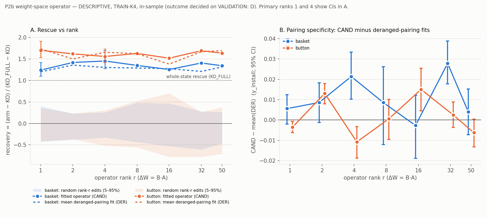

# P2b rescue vs rank — TRAIN-K4 (DESCRIPTIVE, IN-SAMPLE)

> **DESCRIPTIVE ONLY.** TRAIN-K4 (268 rows / 67 domains, then the BASE option-mass key set: basket 179 keys / 63
> domains, button 239 / 67) is IN-SAMPLE for the CAND, DER and SHUF fits (fit on full TRAIN). It never changes a
> verdict or the outcome. The preregistered outcome is **D**, decided on VALIDATION at ranks {1,4}
> (`P2B_VAL_READ_DRAFT_LOG_ENTRY.md`). Ranks 2, 8, 16, 32 and 50 inform curve shape only.

## Table (`*` = primary rank; its row comes from the frozen S-135 arms)

| codeword | r | recovery [CI] | frac BASE−KO [CI] | vs RAND | vs DER | vs full | CAND − mean(DER) [CI] | RAND recovery p5/med/p95 | ‖ΔW‖_F | #params | fit preserve dmg | BASE_CAND − BASE |
|---|---|---|---|---|---|---|---|---|---|---|---|---|
| basket | 1* | 1.24 [1.09, 1.41] | 0.70 [0.63, 0.76] | 1/62 | 9/16 | 9/82 | +0.006 [-0.002, +0.012] | -0.42/-0.01/+0.40 | 44.9 | 346,112 | 0.0006 | -0.042 |
| basket | 2 | 1.42 [1.24, 1.63] | 0.80 [0.72, 0.86] | 1/42 | 2/6 | 2/52 | +0.009 [-0.001, +0.018] | -0.38/-0.12/+0.23 | 53.8 | 692,224 | 0.0012 | -0.015 |
| basket | 4* | 1.45 [1.27, 1.69] | 0.82 [0.74, 0.89] | 1/62 | 2/16 | 2/82 | +0.021 [+0.010, +0.033] | -0.33/-0.04/+0.26 | 55.5 | 1,384,448 | 0.0016 | +0.001 |
| basket | 8 | 1.35 [1.18, 1.55] | 0.76 [0.68, 0.83] | 1/42 | 2/6 | 2/52 | +0.009 [-0.012, +0.026] | -0.43/-0.05/+0.48 | 83.2 | 2,768,896 | 0.0026 | -0.004 |
| basket | 16 | 1.25 [1.10, 1.44] | 0.70 [0.63, 0.77] | 1/42 | 4/6 | 4/52 | -0.003 [-0.019, +0.012] | -0.53/-0.04/+0.46 | 79.3 | 5,537,792 | 0.0031 | -0.021 |
| basket | 32 | 1.40 [1.25, 1.60] | 0.79 [0.72, 0.86] | 1/42 | 1/6 | 1/52 | +0.028 [+0.018, +0.039] | -0.61/-0.17/+0.28 | 68.8 | 11,075,584 | 0.0024 | -0.005 |
| basket | 50 | 1.34 [1.18, 1.54] | 0.75 [0.68, 0.82] | 1/42 | 2/6 | 2/52 | +0.004 [-0.007, +0.015] | -0.46/-0.06/+0.26 | 72.3 | 17,305,600 | 0.0022 | -0.024 |
| button | 1* | 1.70 [1.53, 1.91] | 0.87 [0.80, 0.94] | 1/62 | 13/16 | 13/82 | -0.004 [-0.006, -0.001] | -0.42/-0.05/+0.36 | 38.9 | 346,112 | 0.0005 | +0.001 |
| button | 2 | 1.62 [1.46, 1.80] | 0.83 [0.76, 0.89] | 1/42 | 1/6 | 1/52 | +0.013 [+0.008, +0.018] | -0.36/-0.13/+0.23 | 50.0 | 692,224 | 0.0008 | -0.005 |
| button | 4* | 1.55 [1.41, 1.73] | 0.79 [0.74, 0.85] | 1/62 | 14/16 | 14/82 | -0.011 [-0.019, -0.003] | -0.52/+0.01/+0.30 | 60.2 | 1,384,448 | 0.0015 | -0.004 |
| button | 8 | 1.63 [1.48, 1.79] | 0.83 [0.77, 0.89] | 1/42 | 4/6 | 4/52 | +0.001 [-0.009, +0.010] | -0.56/-0.04/+0.52 | 75.1 | 2,768,896 | 0.0019 | +0.007 |
| button | 16 | 1.52 [1.36, 1.69] | 0.77 [0.70, 0.84] | 1/42 | 2/6 | 6/52 | +0.015 [+0.005, +0.025] | -0.78/-0.18/+0.70 | 100.3 | 5,537,792 | 0.0029 | +0.003 |
| button | 32 | 1.69 [1.51, 1.90] | 0.86 [0.80, 0.93] | 1/42 | 3/6 | 3/52 | +0.002 [-0.004, +0.009] | -0.78/-0.16/+0.26 | 79.2 | 11,075,584 | 0.0017 | +0.002 |
| button | 50 | 1.63 [1.46, 1.83] | 0.83 [0.77, 0.90] | 1/42 | 4/6 | 4/52 | -0.006 [-0.013, +0.000] | -0.71/-0.16/+0.38 | 82.4 | 17,305,600 | 0.0018 | -0.004 |

## How to read the columns

- **recovery** = mean_d(CAND − KO) / mean_d(KO_FULL − KO): the fraction of the whole-state rescue at layer 18.
  Values > 1 OVERSHOOT it. **frac BASE−KO** = mean_d(CAND − KO) / mean_d(BASE − KO). Both use domain-bootstrap CIs.
- **Rank columns:** rank of mean_d(CAND − KO) within each control set (ties count against CAND).
  - Primary ranks: 61 RAND + 5 SHUF + 15 DER (full family /82).
  - Descriptive ranks: 41 RAND + 5 SHUF + 5 DER (full family /52).
  - So the "vs DER" denominators differ (/16 vs /6), and p-floors differ.
- **CAND − mean(DER):** domain-paired bootstrap of CAND minus the mean of the norm-matched deranged-pairing fits.
- **RAND band:** the 5th/50th/95th percentiles of the random norm-matched rank-r edits' recovery.
- **‖ΔW‖_F:** total over 26 modules (o_proj + down_proj, layers 6–18). **#params** = Σ r·(in+out).
- **fit preserve dmg:** fitting-side damage on the TRAIN preserve set, in units of the KO→clean gap.
  **BASE_CAND − BASE:** y change on clean prompts.

## Descriptive reading (TRAIN, in-sample)

1. **Rescue is rank-flat.** Recovery is 1.24–1.45 for basket and 1.52–1.70 for button at every rank 1–50.
   Higher rank does not increase rescue. ‖ΔW‖ grows 1.6× (basket) and 2.1× (button) from r1 to r50, peaking at 2.6× at button r16; #params grows 50×.
2. **Random edits never compete.** CAND ranks 1st among the random edits at every rank, for both codewords; the
   random band sits around 0, from −0.8 to +0.7.
3. **Pairing specificity is small and not monotone in rank.**
   - Basket: CAND − mean(DER) has CI-lo > 0 at r4 and r32 only (+0.021, +0.028).
   - Button: CI-lo > 0 at r2 and r16 (+0.013, +0.015), and CI-hi < 0 at r1 and r4.
   - With 5 descriptive ranks per codeword, isolated positive cells are expected by chance; no rank trend is
     claimed.
4. **Preservation stays small at all ranks.** Fit-side damage is ≤ 0.003 of the gap; |BASE_CAND − BASE| ≤ 0.042.

## Provenance

- **Jobs** (all on n-503, single attempt, DONE rc=0, one model load):
  - r1/r4 TRAIN: 1023012+1034929 / 1023508 (basket) and 1023264+1035131 / 1023509 (button); see S-135.
  - Descriptive: evalB 1040759 / 1040766 ({2,8,32}, 168 arms each); evalC 1040700 / 1040701 ({16,50}, 112 arms each).
  - All descriptive cells are single-host (liveness from 1023012 / 1023264 on n-503), so no overlap file is needed.
- **Analyzer:** p2b_analyze.py 5bafd092…. Outputs: `p2b_<cw>_descriptive_ranks_train.json`; r1/r4 rows from
  `p2b_<cw>_neutpos_train.json` (same frozen arms and verdicts as S-135, with the review-5 fields).
- **Machine-readable:** `P2B_RANK_CURVE_TRAIN.json`.
